<p align="center">
  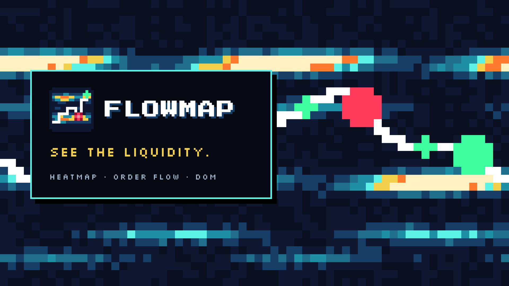
</p>

# FlowMap Mobile

FlowMap Mobile brings the FlowMap liquidity heatmap to Android. It shows where resting orders and estimated liquidation clusters sit, how price moves through them, and what the market is saying about it, all on a phone. The order book, trades and liquidations stream directly from Binance and Bybit. There is no account and no FlowMap server, and the app never places orders.

It is the mobile companion of the [FlowMap Trade Terminal](https://github.com/nazmiefearmutcu/FlowMap-Trade-Terminal) desktop app. It brings together, in one app, parts that were separate desktop projects:

| From | What it contributes to the mobile app |
|---|---|
| **FlowMap** | Live order-book heatmap recorded on the device, best bid/offer, trade bubbles, CVD, DOM ladder and tape; Pixel and Smooth chart styles |
| **Crocodile** | Normalised, keyless venue connectors (Binance USDⓈ-M and Bybit linear) with provenance labels on every number |
| **Awareness** | Curated tier 1–3 publisher feeds, a quality gate against promotional headlines, story clustering and headline tone |
| **showMe** | Market monitor: heat tiles, sortable perpetuals table, watchlist, funding and open interest |

> **Status:** 1.0.1, Android only, English only. See the [changelog](CHANGELOG.md).
>
> **[Download the APK](https://github.com/nazmiefearmutcu/FlowMap-Mobile/releases/latest)**: a development-signed test build for Android 8.0 or later. Check it against `SHA256SUMS.txt`.

## Screens

<p align="center">
  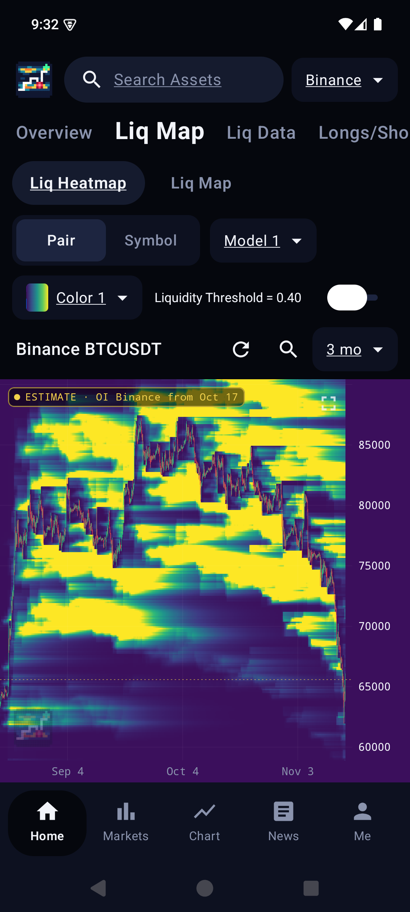
  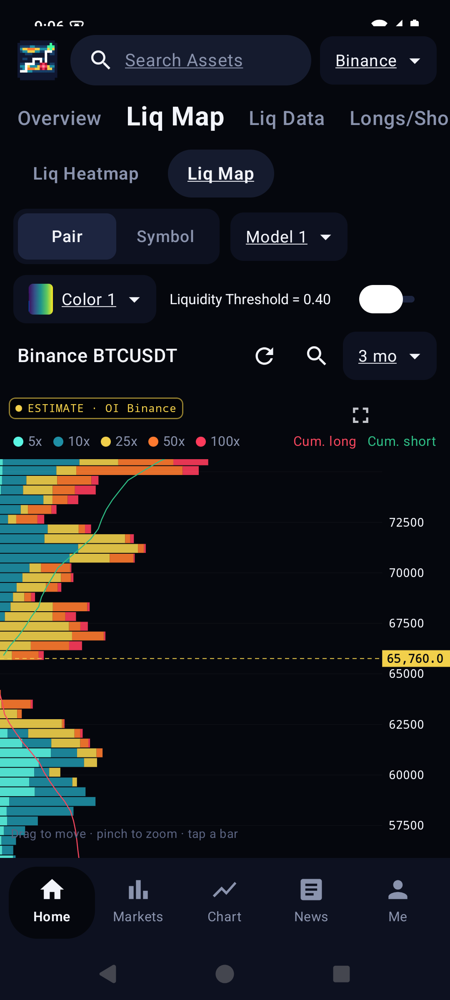
  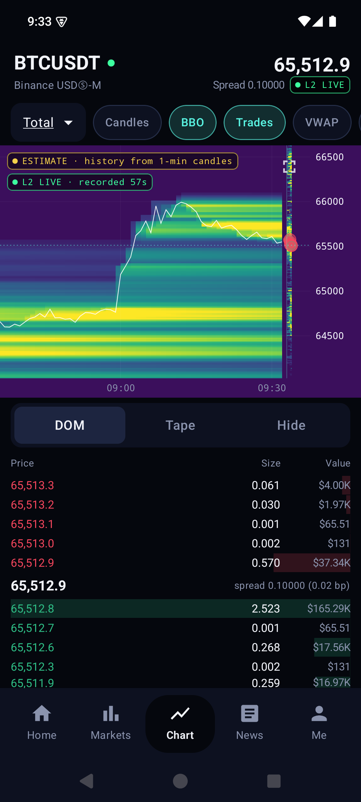
  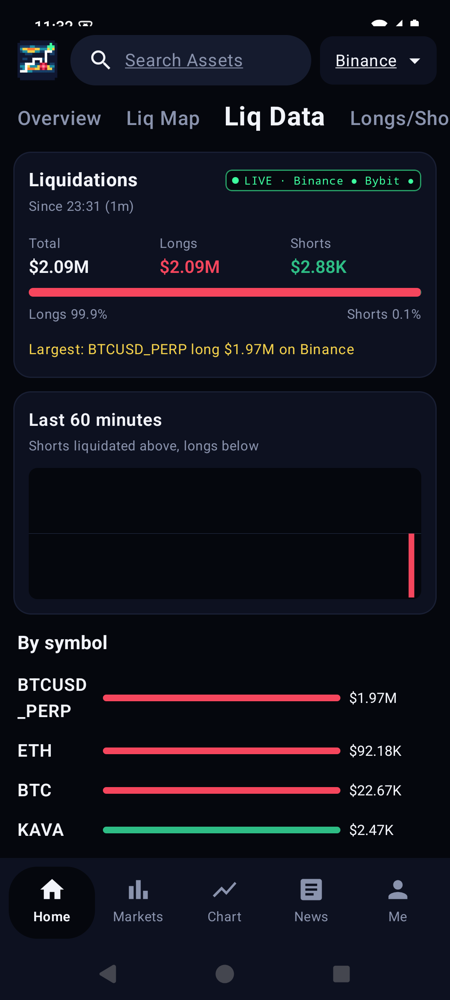
</p>
<p align="center">
  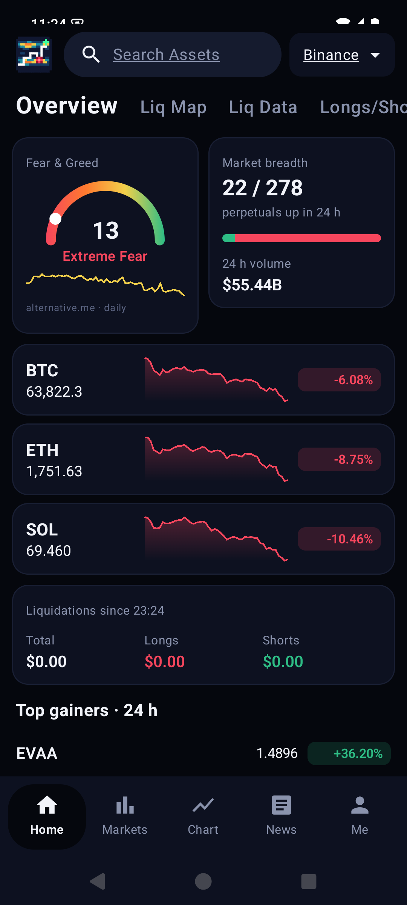
  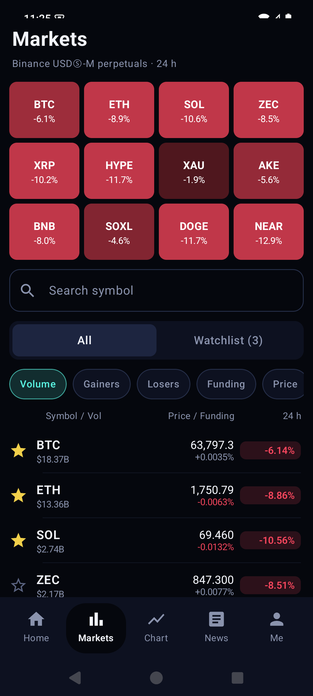
  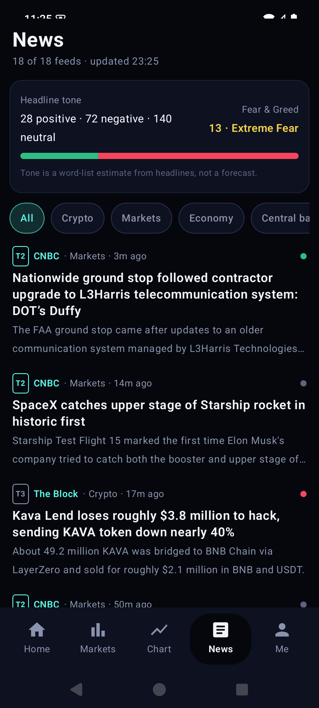
</p>

| Tab | What it shows |
|---|---|
| **Home › Overview** | Fear & Greed, market breadth, BTC/ETH/SOL with 48 h sparklines, the live liquidation tally, top gainers and losers |
| **Home › Liq Map** | *Liq Heatmap*: estimated liquidation levels over time with candles (12 h to 1 y, three leverage models, four colour ramps, liquidity threshold). *Liq Map*: current liquidation notional by price and leverage tier, with cumulative long and short curves. *Pair* uses one venue's open interest; *Symbol* adds up both venues. |
| **Home › Liq Data** | Forced liquidations from Binance (all markets) and Bybit (most active symbols): totals, a per-minute chart, a by-symbol breakdown and a filterable live feed |
| **Home › Longs/Shorts** | Global account, top-trader account, top-trader position and taker buy/sell ratios, from 5 m to 1 d |
| **Home › Funding** | Funding rates of every perpetual on both venues side by side, plus funding history and 14-day open interest for the selected symbol |
| **Markets** | Heat tiles of the most traded contracts, then search, sort (volume, gainers, losers, funding, price) and a starred watchlist. Tap a row to open the live chart; long-press it to open its Liq Map. |
| **Chart** | FlowMap's liquidity heatmap. It opens on the last hour: 12 hours of history are reconstructed from 1-minute candles (marked `ESTIMATE`), and the live order book, recorded once per second on the device, continues at the right edge. A white price line, best bid/offer, trade bubbles, VWAP and CVD can be drawn over it, with candles as an option. Choose Total, Bids or Asks; a DOM ladder or tape sits below. Switching to another symbol pauses the current recording and keeps it, for the two most recent markets. |
| **News** | Stories from the Fed, ECB, BoE, BoJ, SEC, Bloomberg, WSJ, FT, CNBC, MarketWatch, The Economist, CoinDesk, Cointelegraph, Decrypt and The Block, grouped by event, with each publisher's tier |
| **Me** | Venue, chart style, colour ramp, haptics and keep-screen-on settings; the gesture guide; data sources and the disclaimer |

## Gestures

Every chart uses one multi-touch engine. Any part of the chart can be reached without menus.

| Gesture | Effect |
|---|---|
| One finger drag | Pans freely in time and price; a flick keeps it gliding |
| Two or more fingers | Move together to pan. Pinch **sideways** to zoom time, **up and down** to zoom price, **diagonally** for both, always around your fingers. Zoom starts only after a clear spread or pinch (8%), so a two-finger drag never rescales by accident. |
| Tap | Shows the crosshair and tooltip at that point; tap again to hide them |
| Long-press and drag | Scrubs the crosshair, with a haptic tick |
| Drag the price axis / time axis | Stretches that axis only |
| Double-tap the chart | Resets the view; double-tap an axis to fit it again |
| **LIVE** button | Returns to the newest data after you pan back in time |
| ⛶ button | Full-screen chart; Back exits |

## How the numbers are made

FlowMap never presents an estimate as an observation. Every chart carries a badge saying where its data came from.

| Badge | Meaning |
|---|---|
| `L2 LIVE` | Incremental order book from the venue. Binance books are rebuilt from a REST snapshot plus `depthUpdate` events, following Binance's U/u/pu sequencing; a gap triggers a resync. Bybit sends its own snapshot and deltas. |
| `LIVE` | Streamed directly (trades, liquidations) |
| `REST` | Polled from the venue's public API (tickers, ratios, funding, candles) |
| `ESTIMATE` | Computed on the phone. No venue publishes where positions would be liquidated. |

**Liquidation heatmap model.** For each candle, the app estimates newly opened positions from the rise in open interest, plus a small share of turnover. Where Binance publishes taker-buy volume, that splits the positions into longs and shorts; otherwise the split is even. The positions are spread over the candle's price range and placed at each leverage tier's liquidation price (entry × (1 ∓ 1/leverage ± 0.4 % maintenance)). A level disappears once price trades through it, including within the candle that opened it. Every level also fades with the model's half-life as positions are closed voluntarily. The three models differ in leverage mix and half-life:

| Model | Leverage tiers | Half-life |
|---|---|---|
| Model 1 (balanced) | 5x, 10x, 25x, 50x, 100x | 10 days |
| Model 2 (high leverage) | 10x, 25x, 50x, 100x | 4 days |
| Model 3 (conservative) | 3x, 5x, 10x, 20x, 25x | 20 days |

Binance serves only 30 days of open-interest history. For older candles, the model calibrates a turnover share on the period where open interest exists. The badge says `volume only` when no open interest was available at all.

**Heatmap history.** No venue publishes past order books. So that the Chart opens on a full heatmap rather than a few seconds of recording, the app reconstructs 12 hours of history from 1-minute candles. Each candle's traded value is spread over its high–low range, peaking at the close (the band shape of FlowMap desktop's backfill). It is kept as a volume-at-price memory that fades with a 2-hour half-life, so heavily traded prices appear as horizontal bands. This part is labelled `ESTIMATE · history from 1-min candles`. A cyan line marks where the real recording starts.

**Navigation never changes a value.** Panning moves the picture and nothing else. Heatmap cells are combined into fixed blocks tied to the data, liquidation-map buckets are fixed groups of price rows, and every colour and bar scale is set from the data, not from what is on screen. Zooming switches between power-of-two block sizes. Price auto-fit never runs during a pan: it applies on first view, on double-tap, and to new live data at the live edge. A two-finger drag only pans until the fingers clearly spread or pinch. The inspection crosshair is pinned to a time and price, not a screen position, so its tooltip keeps reporting the same cell while you pan. The live heatmap learns its colour scale over its first minute and then holds it, so recorded history keeps its colours.

**Live data limits.** Venues publish liquidations live only, so totals start when the app opens and exclude time spent in the background. Binance sends at most one liquidation per symbol per second. The order-book heatmap exists only for the time the app has been recording: about 50 minutes at one column per second, kept in memory and never written to disk. If Binance refuses your region (HTTP 451/403), the app switches to Bybit and says so.

**Not investment advice.** FlowMap Mobile does not recommend any security, is not a broker and cannot place trades. Data can be delayed, incomplete or unavailable. Each provider's terms of use apply to the data you view.

## Privacy

- No account, no analytics, no advertising identifiers, no crash reporting.
- Network requests go only to `fapi.binance.com`, `fstream.binance.com`, `api.bybit.com`, `stream.bybit.com`, `api.alternative.me` and the RSS hosts listed in [`News.kt`](app/src/main/java/com/nazmiefearmutcu/flowmap/mobile/data/news/News.kt). Cleartext HTTP is disabled.
- Settings and the watchlist are stored in the app's private preferences.
- Permissions: `INTERNET` and `ACCESS_NETWORK_STATE` only.

## Build

Requirements: JDK 17 and an Android SDK with platform 36. The Gradle wrapper downloads Gradle 8.13.

```bash
./gradlew :app:testDebugUnitTest
```

```bash
./gradlew :app:assembleDebug
```

Release builds are minified with R8 (about 1.3 MB). To sign one for Google Play, set `FLOWMAP_STORE_FILE`, `FLOWMAP_STORE_PASSWORD`, `FLOWMAP_KEY_ALIAS` and `FLOWMAP_KEY_PASSWORD` (or a git-ignored `keystore.properties`), then build the bundle:

```bash
./gradlew :app:bundleRelease
```

Without signing variables, the release APK is signed with the debug key so that it can be side-loaded for testing.

Minimum Android version: 8.0 (API 26). Target: API 36.

### Project layout

```
app/src/main/java/com/nazmiefearmutcu/flowmap/mobile/
├── data/            venue REST clients, WebSocket streams, live session, liquidation hub, news, settings
├── engine/          liquidation model, order book, depth recorder, palettes, indicators (pure Kotlin, unit-tested)
└── ui/
    ├── chart/       viewport math, multi-touch gestures, heatmap rasteriser, axes, tooltip, overlays
    ├── brand/       16×16 pixel logo and 5×7 pixel font
    ├── components/  shared controls
    └── screens/     home (overview, liq map, liq data, longs/shorts, funding), markets, chart, news, me
scripts/brand/pixel_assets.py   generates launcher icons and the README artwork from the logo grid
```

## Brand

<p align="center">
  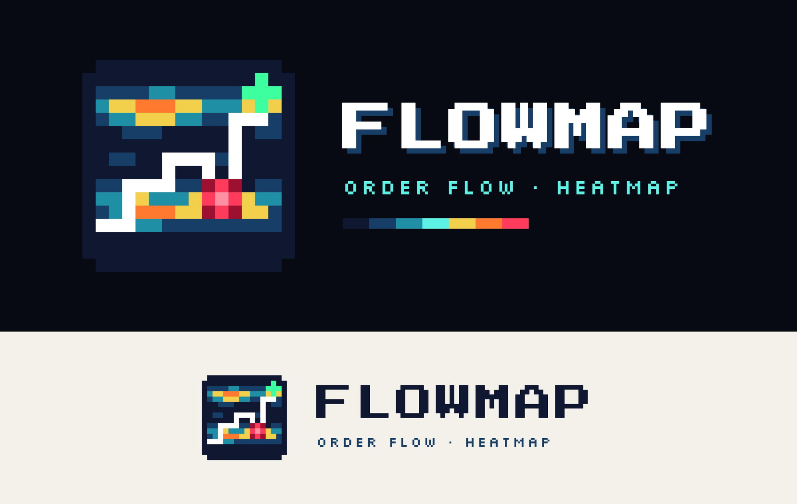
</p>

The logo is a 16 × 16 pixel grid. Every pixel is a whole number, so it scales to 16, 32, 64, 128 and 256 px without blur. The same grid draws the launcher icon, the in-app logo and the wordmark.

<p align="center">
  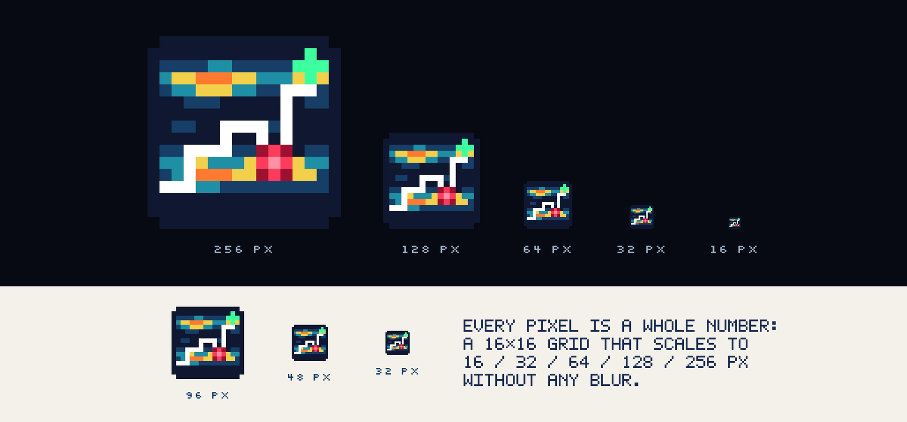
</p>

<p align="center">
  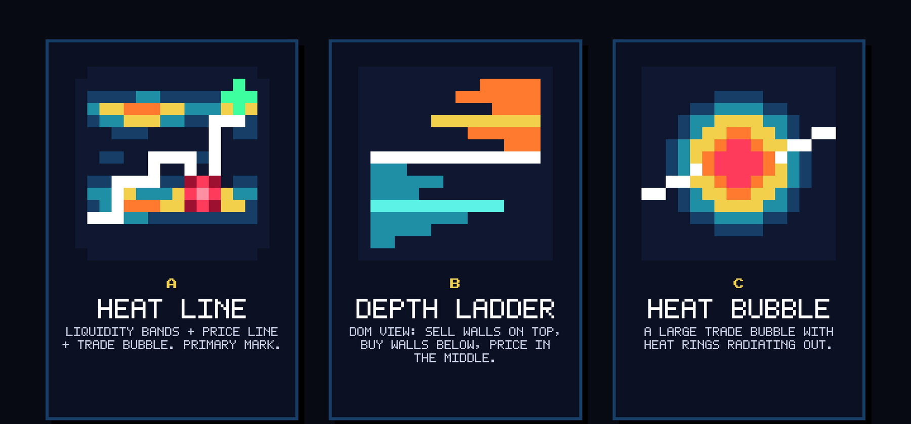
</p>

To regenerate the icons and artwork:

```bash
python scripts/brand/pixel_assets.py --pdf "Pixel Bookmap Logo.pdf"
```

## Licence

[Apache License 2.0](LICENSE). Copyright 2026 Nazmi Efe Armutcu.
